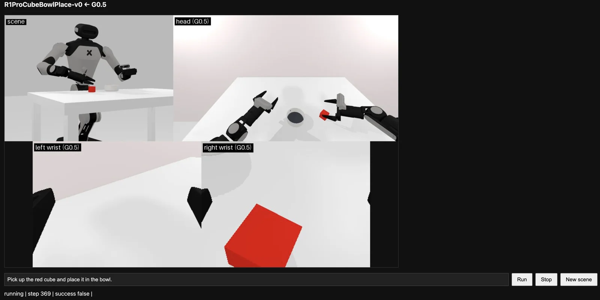

# xmem: G0.5 in GalaxeaManipSim

Type a prompt in a browser → the [G0.5 VLA](https://github.com/OpenGalaxea/GalaxeaVLA) predicts actions → an R1 Lite or R1 Pro carries them out in this simulator.



**Requirements:** Linux, an NVIDIA GPU with ≥16 GB free (tested on RTX 5090), `git`, [uv](https://docs.astral.sh/uv/getting-started/installation/), a [Hugging Face](https://huggingface.co) account, ~30 GB disk (sim env 7 GB, VLA env 11 GB, weights 12 GB).

## 1. Set up

```bash
mkdir xmem && cd xmem
git clone -b xmem/cube-bowl https://github.com/kalieching/GalaxeaManipSim.git
bash GalaxeaManipSim/xmem/setup.sh
```

`setup.sh` clones [GalaxeaVLA](https://github.com/OpenGalaxea/GalaxeaVLA) next to this repo (pinned to `89f2322`), builds both Python environments with uv, and downloads the simulator's object meshes (~490 MB) and the G0.5 weights (~12 GB). It is safe to re-run, since finished steps are skipped.

The weights are gated. Before the first run, accept the license at <https://huggingface.co/OpenGalaxea/G05> (approved instantly). If you are not logged in to Hugging Face, `setup.sh` stops and prints the login command.

## 2. Run in the simulator

```bash
bash GalaxeaManipSim/xmem/up.sh --robot r1lite   # or --robot r1pro
```

This starts the policy server on the GPU with the most free memory and then the simulator. It prints `Ready: open http://localhost:8000` after 1–2 minutes. Ctrl+C stops both. Logs are in `xmem/logs/`. Run `up.sh --help` for the other options (`--gpu`, `--port`, `--web-port`, `--max-steps`).

**Browser:** open <http://localhost:8000>. If the GPU machine is remote, forward port 8000 first. In VS Code Remote-SSH, use Ports panel → Forward a Port → `8000`. Otherwise, run `ssh -L 8000:127.0.0.1:8000 <user>@<gpu-host>` on your laptop.

**Run** runs the prompt on the current scene, for up to `--max-steps` (default 1200, which is 72 s of sim time). **New scene** re-randomizes the cube and bowl.

## 3. Run on a real robot

The real robot talks to the same policy server, through GalaxeaVLA's ROS2 clients in `GalaxeaVLA/experiments/r1lite` and `experiments/r1pro`. On the GPU machine:

```bash
bash GalaxeaManipSim/xmem/up.sh --robot r1pro --real   # or --robot r1lite
```

This starts only the server. It then prints the two commands to run on the robot's computer, which needs ROS2 Humble and a copy of GalaxeaVLA:

1. An SSH tunnel from the robot's port 8080 to the server. The clients' default `config.toml` already points at `127.0.0.1:8080`, so it needs no edits.
2. The client: `python run.py --config config.toml` in `experiments/<robot>`. See that folder's README for its Python setup, ROS2 topics and instruction file.

This path has not been tested on hardware from this repo yet.

## 4. Collect kitting data

`R1LiteKitting-v0` / `R1ProKitting-v0`: put the 3 objects of a scene into its container, in any order. There are 10 scenes drawn from 4 containers and 12 objects, with the same layouts for both robots (`kitting_layouts.json`).

```bash
cd GalaxeaManipSim
.venv/bin/python xmem/collect_kitting.py --robot r1pro --policy scripted      # scripted planner, no policy server
bash xmem/up.sh --robot r1lite --server-only                                   # or G0.5: start the server, then
.venv/bin/python xmem/collect_kitting.py --robot r1lite --policy g05
.venv/bin/python xmem/replay_kitting.py datasets/R1ProKitting-v0/scripted/demo_0.h5 --cameras
```

Each kit is one full trajectory, saved to `datasets/<Robot>Kitting-v0/<policy>/demo_<n>.h5` with every step's state, action and simulator state. Failed attempts are rewound and kept in `failed/`, so a kit holds only the successful pick and places. `env.unwrapped.restore(...)` puts the simulation back to any recorded step. `replay_kitting.py` renders a preview video, and with `--cameras` it writes every step of each robot camera for training.

## Changes from upstream

| Where (under `GalaxeaManipSim/galaxea_sim/` unless noted) | Change | Why |
|---|---|---|
| `envs/robotwin/cube_bowl_place.py` | New task `R1LiteCubeBowlPlace-v0` / `R1ProCubeBowlPlace-v0`: red cube → bowl, success = cube released inside | Target task |
| same | Stiff arm drives (1e5/4e3 vs 1e3/200) | Default arms need ~10 steps to reach each 15 Hz target |
| same | Objects kept in the head camera's view, with R1 Pro's cube near its grippers | Policy must see the cube |
| `envs/robotwin/__init__.py` | R1 Pro starts at the mean pose of G0.5's real R1 Pro data | From upstream's pose G0.5 barely moves |
| `assets/r1_pro/robot.urdf` | Finger collision box rotated 90° to match the finger mesh | Grasped objects sat ~12 mm off the visible fingers |
| `envs/robotwin/kitting.py`, `kitting_layouts.json` | New task `R1LiteKitting-v0` / `R1ProKitting-v0`: 3 objects → container, layouts shared by both robots, exact restore of any step | Paired kitting data |
| `scripts/fetch_assets.py` | Asset download from Hugging Face, plus the kitting meshes from RoboTwin 2.0 (basket handle removed) | Upstream Google Drive link is dead |
| `GalaxeaManipSim/xmem/collect_kitting.py`, `scripted_kitting.py`, `replay_kitting.py` | Kit collection with G0.5 or a scripted mplib planner, replay and camera export | Kitting data |
| `GalaxeaManipSim/xmem/serve_policy_5090.py` | Vision encoder on PyTorch SDPA | FlashAttention-4 fails on RTX 5090 |
| server flags | `discrete_action=true continuous_action=false` | R1 Pro scored 0/12 without them |
| `GalaxeaManipSim/xmem/setup.sh`, `up.sh` | One-command setup and launch, with uv instead of conda for the sim env | Fewer manual steps, one tool for both envs |
