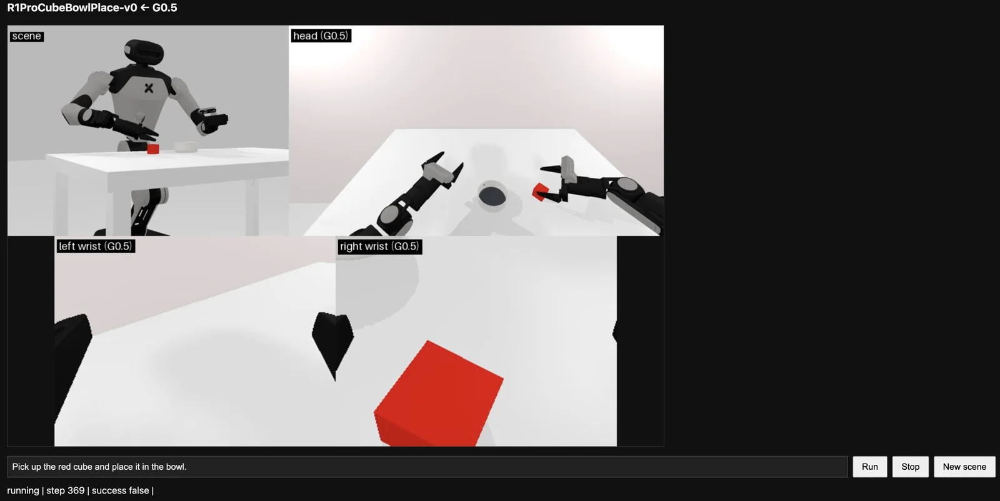

# xmem: G0.5 in GalaxeaManipSim

Type a prompt in a browser → the [G0.5 VLA](https://github.com/OpenGalaxea/GalaxeaVLA) predicts actions → an R1 Lite or R1 Pro carries them out in this simulator.



**Requirements:** Linux, an NVIDIA GPU with ≥16 GB free (tested on RTX 5090), `git`, [conda](https://docs.conda.io/en/latest/miniconda.html), [uv](https://docs.astral.sh/uv/getting-started/installation/), a [Hugging Face](https://huggingface.co) account, ~30 GB disk (sim env 6 GB, VLA env 11 GB, weights 12 GB).

## 1. Get the code

```bash
mkdir xmem && cd xmem
git clone -b xmem/cube-bowl https://github.com/kalieching/GalaxeaManipSim.git
git clone https://github.com/OpenGalaxea/GalaxeaVLA.git
git -C GalaxeaVLA checkout 89f2322
```

## 2. Simulator (in `xmem/GalaxeaManipSim`)

```bash
cd GalaxeaManipSim
conda create -n galaxea-sim python=3.10 -y && conda activate galaxea-sim
pip install -e .
pip install "numpy<2" "setuptools<81" websockets msgpack
python -m galaxea_sim.scripts.fetch_assets   # ~2 min, ~490 MB of object meshes
cd ..
```

## 3. VLA (in `xmem/GalaxeaVLA`)

```bash
conda deactivate
cd GalaxeaVLA
uv tool install cmake   # only if `cmake --version` fails
CMAKE_POLICY_VERSION_MINIMUM=3.5 uv sync --index-strategy unsafe-best-match
```

Accept the license at <https://huggingface.co/OpenGalaxea/G05> (gated, approved instantly) while logged in to Hugging Face, then download the weights (~12 GB):

```bash
.venv/bin/hf auth login   # paste a read token from https://huggingface.co/settings/tokens
.venv/bin/hf download OpenGalaxea/G05 --local-dir checkpoints \
  --include "g05-base/*" --include "action_tokenizer.pt" --include "qwen3_5_2b_base_processor/*"
cd ..
```

## 4. Run

**Terminal 1: policy server.** Run this in `xmem/GalaxeaVLA`, with `CUDA_VISIBLE_DEVICES` set to a free GPU. It is ready when it prints `Policy server listening`, after 1–2 minutes.

```bash
cd xmem/GalaxeaVLA
CUDA_VISIBLE_DEVICES=0 PYTHONPATH=src:scripts .venv/bin/python ../GalaxeaManipSim/xmem/serve_policy_5090.py \
  --ckpt_path checkpoints/g05-base/checkpoints/model_state_dict.pt --host 127.0.0.1 --port 8765 \
  eval_embodiment=galaxea_r1lite model.model_arch.attn_implementation=sdpa \
  model.model_arch.discrete_action=true model.model_arch.continuous_action=false
```

**Terminal 2: simulator and web page.** Run this in `xmem/GalaxeaManipSim`. It is ready when it prints `Open http://127.0.0.1:8000`.

```bash
cd xmem/GalaxeaManipSim
conda activate galaxea-sim
python xmem/vla_client.py --robot r1lite
```

**Browser:** open <http://localhost:8000>. If the GPU machine is remote, forward port 8000 first. In VS Code Remote-SSH, use Ports panel → Forward a Port → `8000`. Otherwise, run `ssh -L 8000:127.0.0.1:8000 <user>@<gpu-host>` on your laptop.

**Run** runs the prompt on the current scene, for up to `--max-steps` (default 1200, which is 72 s of sim time). **New scene** re-randomizes the cube and bowl.

**R1 Pro:** use `eval_embodiment=galaxea_r1pro` in terminal 1 and `--robot r1pro` in terminal 2. Stop both with Ctrl+C.

## Changes from upstream

| Where (under `GalaxeaManipSim/galaxea_sim/` unless noted) | Change | Why |
|---|---|---|
| `envs/robotwin/cube_bowl_place.py` | New task `R1LiteCubeBowlPlace-v0` / `R1ProCubeBowlPlace-v0`: red cube → bowl, success = cube released inside | Target task |
| same | Stiff arm drives (1e5/4e3 vs 1e3/200) | Default arms need ~10 steps to reach each 15 Hz target |
| same | Objects kept in the head camera's view, with R1 Pro's cube near its grippers | Policy must see the cube |
| `envs/robotwin/__init__.py` | R1 Pro starts at the mean pose of G0.5's real R1 Pro data | From upstream's pose G0.5 barely moves |
| `assets/r1_pro/robot.urdf` | Finger collision box rotated 90° to match the finger mesh | Grasped objects sat ~12 mm off the visible fingers |
| `scripts/fetch_assets.py` | Asset download from Hugging Face | Upstream Google Drive link is dead |
| `GalaxeaManipSim/xmem/serve_policy_5090.py` | Vision encoder on PyTorch SDPA | FlashAttention-4 fails on RTX 5090 |
| server flags | `discrete_action=true continuous_action=false` | R1 Pro scored 0/12 without them |

## Notes

- **Zero-shot:** `g05-base` succeeds rarely: 2/8 runs on R1 Lite, and 0–1/10 on R1 Pro for each setting tested. Naming the color ("red cube") seemed to help in manual runs. Only R1 Lite and R1 Pro have G0.5 embodiments.
- **Speed:** about half real time (~40 ms/step for the live views + ~0.45 s inference every 16 steps).
- **Pins:** `numpy<2` (mplib 0.2.1 segfaults on numpy 2), `setuptools<81` (sapien needs `pkg_resources`). Don't commit `GalaxeaVLA/uv.lock` (`uv sync` rewrites its index URLs).
- **`address already in use`:** an old server or client is still running. Stop it with `pkill -f serve_policy_5090.py` or `pkill -f xmem/vla_client.py`, then restart. After a network change, re-forward port 8000.
- **License:** G0.5 is non-commercial and may not be exposed to third parties, so keep both servers on `127.0.0.1`.
